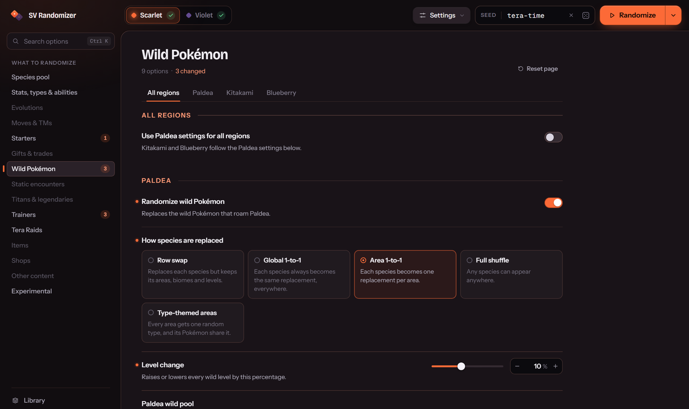
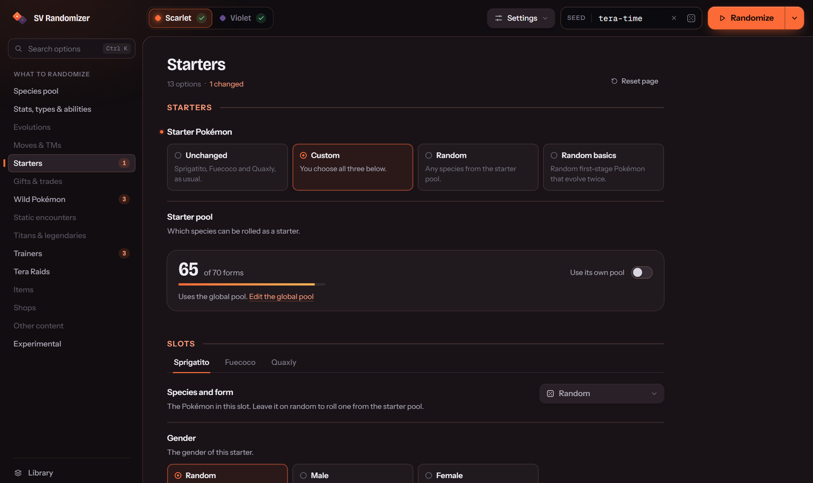
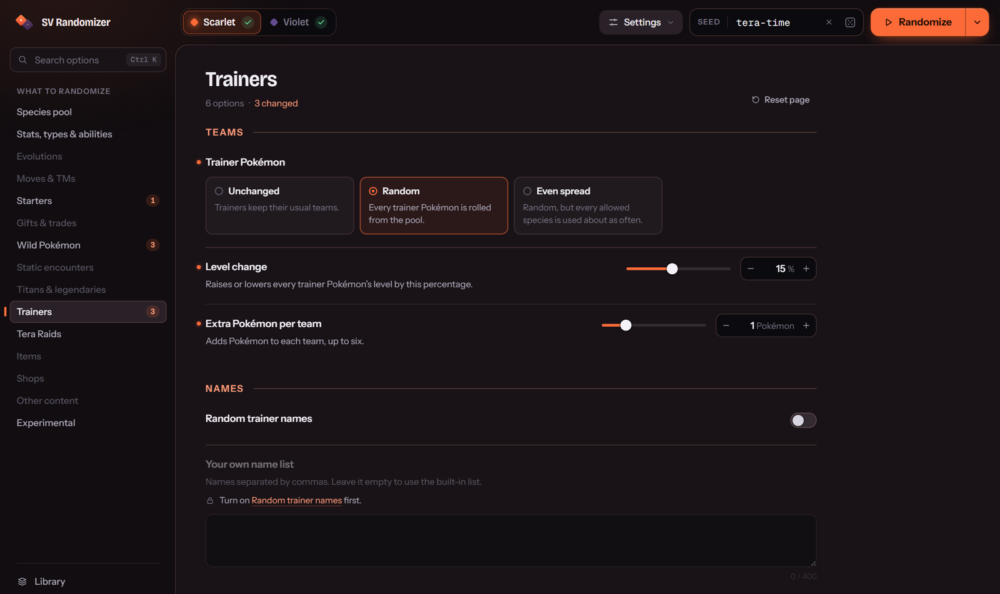
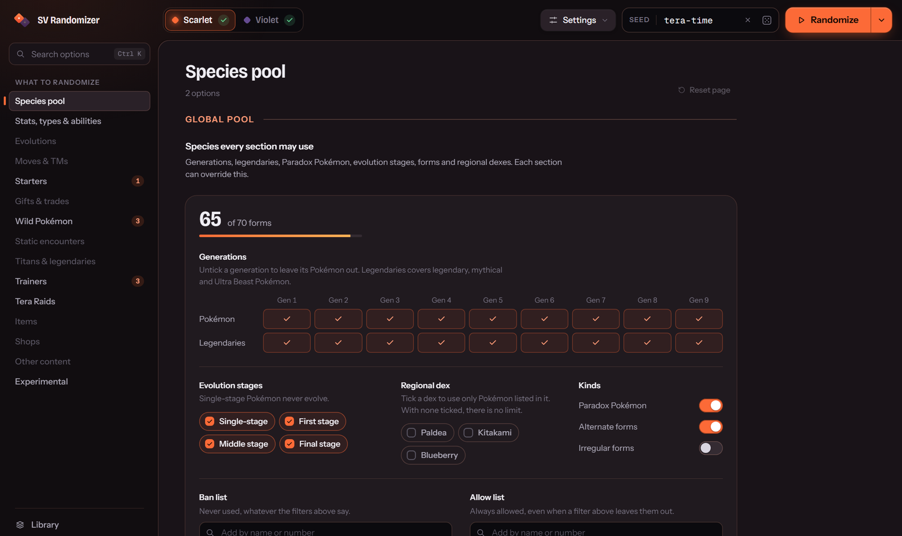
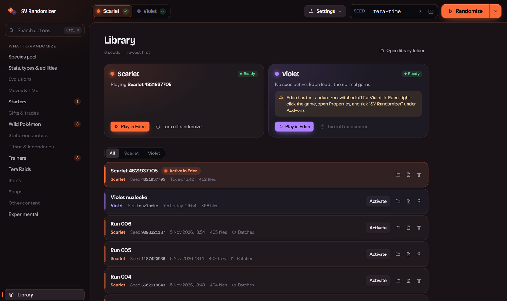

# SV Randomizer

A randomizer for Pokémon Scarlet and Violet, built for the Eden Switch emulator. Pick your options in a desktop app, press Randomize, and play a new adventure through Paldea, Kitakami and Blueberry Academy.



It reads everything it needs from your own game dump, writes the result as an Eden mod, and never touches your original files. Turning the mod off gives you the normal game back, and your save keeps working either way.

## What it can change

- **Species pool.** Choose which Pokémon can appear anywhere: by generation, legendaries, Paradox Pokémon, evolution stages, regional forms and regional Pokédex, with ban and allow lists.
- **Pokémon data.** Base stats, types, abilities, EXP curves, catch rates and egg hatching.
- **Evolutions.** Random evolutions, evolutions at every level, and fixes for trade, time-of-day and region-locked methods.
- **Moves and TMs.** Level-up learnsets, move power, accuracy, PP, type and category, TM moves, TM compatibility and TM crafting costs.
- **Starters.** Random, random basics that evolve twice, or your own three. The new starters appear in the cutscenes from the moment you choose.
- **Gifts and trades.** Gift Pokémon, eggs and in-game trades.
- **Wild Pokémon.** Separate settings for Paldea, Kitakami and Blueberry: row swap, one-to-one replacements globally or per area, type-themed areas or a full shuffle, plus levels and held items.
- **Static encounters.** Overworld Pokémon placed in fixed spots.
- **Titans and legendaries.** Titans, the Treasures of Ruin, Area Zero, the DLC story fights and more, with their cutscene models changed to match.
- **Trainers.** Teams, levels, double battles, held items, Tera types, trainer names and classes.
- **Tera Raids.** Raid bosses per region and star tier, shininess, Tera types and rewards.
- **Items and shops.** Field items, Pickup and Let's Go finds, material drops, and shop stock. The Pokémon Center counter keeps its usual items and adds random extras that grow with your gym badges.

Every run produces a spoiler log. You can also randomize several seeds in one batch, save your settings as files, and share them as short codes.

## Screenshots

| Starters | Trainers |
| --- | --- |
|  |  |
| **Species pool** | **Library** |
|  |  |

## What you need

- **Windows 10 or 11.**
- **Eden**, with your Pokémon Scarlet or Violet installed and working.
- **Your own dump of the game**: the base game cartridge (`.xci`) and the **4.0.0 update** (`.nsp`). Only version 4.0.0 is supported. The Teal Mask and The Indigo Disk content is part of that update, but you need the DLC installed in Eden to play it.
- **Your own `prod.keys`**, dumped from your Switch. The randomizer needs it to read the game files.

The app does not include any game data or keys, and it never asks for or downloads them.

## Install

1. Open the [latest release](../../releases/latest).
2. Download `SV-Randomizer-<version>-setup.exe` and run it, or download the portable zip and unzip it anywhere.
3. Windows may warn that the app is from an unknown publisher, because the build is not code-signed. Choose **More info**, then **Run anyway**.

## How to use it

1. **Open the app.** It looks for Eden's data folder, your `prod.keys` and your game files in the folders Eden scans for games. If something is missing, set it under **App settings**.
2. **Choose Scarlet or Violet** at the top.
3. **Pick your options.** Start from a preset under **Settings** (Light, Balanced, Hard or Chaos) or go through the pages on the left. A dot marks every option you changed.
4. **Press Randomize.** Leave the seed empty for a random one, or type a seed to get the same result again. The arrow next to the button starts a batch of several seeds.
5. **Play.** In the **Library**, activate the seed you want and press **Play in Eden**. Only one seed per game is active at a time. Turn the randomizer off there to go back to the normal game.

The spoiler log for every seed is in the Library, next to the seed.

## How it works

Scarlet and Violet keep their data in one large archive. The randomizer decrypts your base game and update, reads the tables it changes, and writes a mod folder named `SV Randomizer` into Eden's `load/<title id>/` folder. That folder holds the changed files and a patched archive index that sends the game to them. Your game files stay as they are.

## Good to know

- **Windows path length.** Eden ignores mod files whose full path is longer than 260 characters, and the game then freezes. The app refuses to write to a folder that is too deep. If you moved Eden's load folder, keep it close to the drive root.
- **Loading screen hangs.** Eden sometimes stays on the loading screen with the spinning compass when you load a save, with or without the randomizer. Restart the game; nothing is lost.
- **Gimmighoul stays vanilla.** Changing the roaming and chest Gimmighoul crashes the game's scripts, so the randomizer leaves them and their battles alone.
- **Shops of the same kind share one list.** Every Pokémon Center sells the same items, and so does every bakery. The game assigns one item list per kind of shop.
- **Only species that are in the game.** Pokémon that Scarlet and Violet don't include can't be added, because the game has no models for them.
- **In-game testing.** The early game, starters, trainers, shops, some titans, Team Star base, and the scripted battle in the catching lesson are checked in playthroughs. Many other options are verified against the game data by automated tests but not yet in a full playthrough. If something breaks, please open an issue with your settings code and seed.

## Building from source

You need [Rust](https://rustup.rs) 1.89 or newer, [Node.js](https://nodejs.org) 22, and the [Tauri prerequisites for Windows](https://tauri.app/start/prerequisites/) (the Microsoft C++ build tools and WebView2).

```sh
cd app
npm ci
npx tauri build      # release build: target/release/SV Randomizer.exe and an installer
npx tauri dev        # run the app with live reload
npm run dev          # the UI alone in a browser, with sample data
```

### Tests

```sh
cargo test --workspace --release
```

Most tests read the real game. They skip themselves unless you point them at your files:

| Variable | Meaning |
| --- | --- |
| `SVR_TEST_KEYS` | Path to your `prod.keys`. |
| `SVR_TEST_GAMES` | Folder with the base `.xci` and 4.0.0 update `.nsp`. The files are found by the title ID in their names, such as `0100A3D008C5C000` for Scarlet. |
| `SVR_TEST_TABLES` | Optional. A folder of extracted game tables for the parser comparison tests. |

### Project layout

- `crates/svr-core` reads the Switch containers and the game archive, models the game data, and holds every randomizer section.
- `app` is the desktop app: a Tauri backend in `app/src-tauri` and a Svelte UI in `app/ui`.
- `docs/FEATURE_LIST.md` lists every option with its source and how far it is tested.

### Releasing

Releases are built by the **Release** workflow, which runs only when started by hand. Open **Actions**, choose **Release**, press **Run workflow**, and enter a semantic version such as `1.2.0` or `1.3.0-beta.1`. The workflow runs the tests, builds the app with that version, tags the commit `v<version>`, and publishes a GitHub release with the installer and the portable zip.

## Credits

- [Universal Pokemon Randomizer ZX](https://github.com/Ajarmar/universal-pokemon-randomizer-zx), the model for most of the options.
- [Gonzalooo's Pokémon Scarlet and Violet randomizer](https://github.com/Gonzalooo/Pokemon-Randomizer), a reference for where the game keeps its data.
- [pkNX](https://github.com/kwsch/pkNX), a reference for the game's file formats.
- [oozextract](https://crates.io/crates/oozextract) for decompressing the game archive, plus [Tauri](https://tauri.app) and [Svelte](https://svelte.dev).

## License

SV Randomizer is free software under the [GNU General Public License v3.0 or later](LICENSE).

## Disclaimer

This is a fan project. It is not affiliated with or endorsed by Nintendo, Game Freak, Creatures or The Pokémon Company. Pokémon and all related names are trademarks of their respective owners. Use it only with games and keys you dumped from your own hardware.
